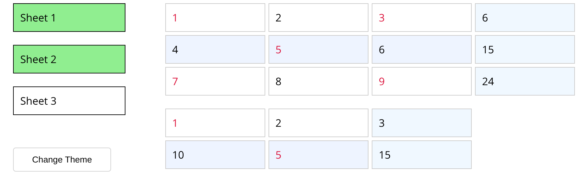

# Spreadsheet Viewer

[](https://github.com/dianaasamkova/spreadsheets-app/actions/workflows/ci.yml)

A multi-sheet table viewer in React: pick any sheets, see a total for every row, and restyle the table live from a theme editor.



> **Context:** a 2024 take-home assignment. I revisited it in 2026, fixed a theme-editor bug, replaced the failing boilerplate test with real ones, added CI and documented the design. See [TECH.md](TECH.md).

## Highlights

- **Several sheets at once.** Toggle any sheets from the sidebar; each one renders as its own table, in the same column grid.
- **Row totals,** computed once per data change (`useMemo`), not on every render.
- **Rule-based theming.** Four rules, *even rows*, *odd rows*, *even values* and *odd values*, each with text and background colour, accepting any CSS colour. Row rules win over value rules, and an empty field falls through to the next rule.
- **Live preview without jank.** Edits are debounced per field, so typing a colour doesn't restyle the table on every keystroke, and quick edits to different fields are never lost.
- **Context-based state.** Separate `SheetsProvider` and `ThemeProvider`, so theme changes don't touch data logic.
- **Behaviour tests** with Testing Library: sheet selection, row totals and the theme editor, with the network mocked.

## Tech stack

React 18 · TypeScript · Context API · CSS Modules · Jest + Testing Library · Create React App

## Quick start

Requires Node 18+ and Yarn 1.

```bash
yarn install
yarn start        # http://localhost:3000
yarn test         # tests
yarn build        # production build
```

The data is a public JSON file that was provided with the assignment. It's fetched at startup, so no setup is needed.

## Project structure

```
src/
├── providers/
│   ├── sheets.tsx      # Fetches sheets; holds the selected sheets
│   └── theme.tsx       # Theme rules
├── components/
│   ├── NavigatioBar.tsx  # Sheet list + "Change Theme" toggle
│   ├── Sheets.tsx        # Tables, row totals, style resolution
│   └── Modal.tsx         # Theme editor with per-field debounce
└── definitions/        # Shared types
```

## Docs

- [TECH.md](TECH.md): architecture, decisions and trade-offs, a 2026 retrospective, and a roadmap.
