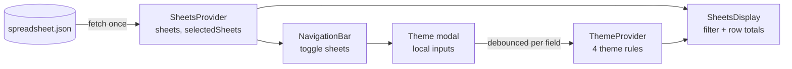

# Spreadsheet Viewer: Technical Notes

## 1. Problem

Show numeric spreadsheets from a remote JSON file. Let the user choose which sheets to see, show the sum of each row, and let them customise the table's colours.

**Acceptance criteria**

- Sheet names load from the API and appear in a sidebar.
- Clicking a name toggles the sheet. Selected sheets render as tables, each row with its total.
- A theme editor sets text and background colour for: even rows, odd rows, even values and odd values.
- Theme changes apply to the table without a reload.

## 2. Architecture

- **Two providers, two concerns.** Data and selection live in `SheetsProvider`; styling lives in `ThemeProvider`. A component reads only the context it needs.
- **The modal keeps local input state.** Inputs update instantly; the shared theme updates after a per-field debounce, so the tables re-render once per edit, not once per keystroke.
- **`SheetsDisplay` derives everything:** the visible sheets and their row totals come from one `useMemo` over `sheets` and `selectedSheets`. The grid width uses the widest row across all sheets, so the tables line up.

## 3. Key decisions

| Decision | Why | Trade-off |
|---|---|---|
| Context API, no Redux | Two small slices of state and a handful of consumers | Every consumer re-renders on any change in its context |
| Style rules resolved per cell at render | Simple and always consistent with the current theme | O(cells) work per render; fine for small sheets |
| Row rules override value rules | Row striping is the stronger visual cue | Not configurable |
| Empty field = no rule | The user can set only a background, only a colour, or nothing | — |
| Free-text CSS colours | Accepts names, hex, `rgb()` and `hsl()` without a picker | No validation; a typo silently does nothing |
| CSS grid for rows | Columns align across sheets of different widths | — |

### Bug fixed in 2026

All eight theme inputs shared **one** debounce timer. Editing a second field within a second cancelled the first edit: its input showed the new value, but the table never applied it. Each field now has its own timer (a `Map` keyed by `category.property` in a ref). A test types into two fields within the delay and checks that both styles apply.

## 4. Quality

- **Tests:** sheet list, selection, row totals, and theme edits in quick succession, with `fetch` mocked and fake timers.
- **CI:** GitHub Actions runs install, tests and a production build on every push and pull request.

## 5. Looking back (2026)

- **Loading and error states.** A failed request is only logged, and the user sees "No spreadsheet selected". I'd show a loading state, an error and a Retry button.
- **Accessibility.** Sheet names are clickable `div`s and the modal isn't a dialog. I'd use toggle buttons (`aria-pressed`), a real `<dialog>` with focus trapping, and labelled inputs.
- **Colour inputs.** I'd validate with `CSS.supports('color', value)` and add `<input type="color">` next to the text field.
- **Totals column.** In narrower sheets the total sits right after the last value, not in a shared "Total" column. I'd pin it to the last grid column with a header.
- **Persistence.** The theme resets on reload. I'd save it to `localStorage`, or to the backend per user.
- **Tooling.** Today I'd use Vite and Vitest instead of Create React App, which is deprecated.

## 6. Roadmap

1. Loading, error and empty states, with retry.
2. Accessible sheet toggles and a theme dialog (keyboard and screen reader).
3. Column totals and a grand total; number formatting.
4. Theme presets, a colour picker and persistence.
5. Virtualised rows for large sheets.
